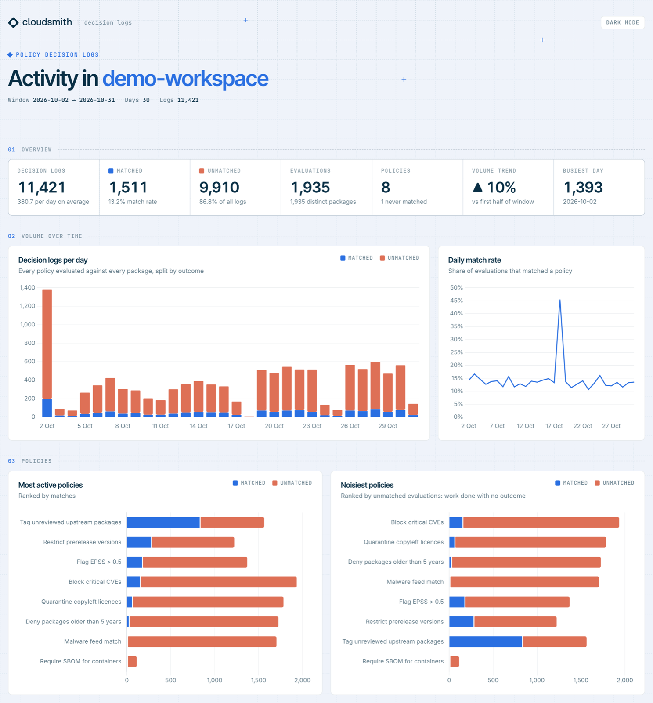
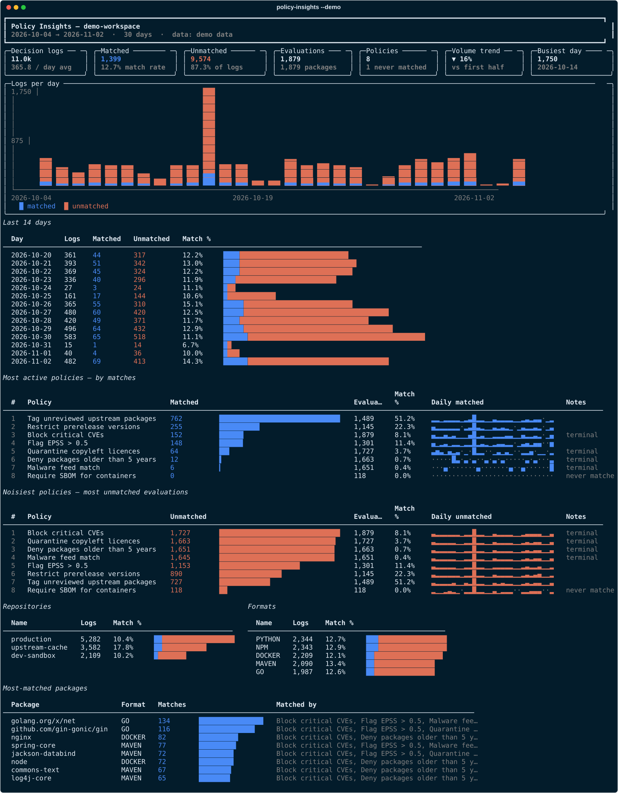

# Policy Insights

<p align="center">
  <a href="pyproject.toml"></a>
  <a href="https://github.com/astral-sh/uv"></a>
  <a href="https://github.com/fullstackspectrum/policy-insights/releases"></a>
  <a href="LICENSE"></a>
  <a href="https://github.com/fullstackspectrum/policy-insights/commits/main"></a>
  
</p>

Visualise [Cloudsmith policy decision logs](https://docs.cloudsmith.com/api/workspaces/policies/decision/logs/v1/list)
in the terminal (Rich) or as an HTML dashboard.

> [!NOTE]
> **This is not an official Cloudsmith tool.** It's a personal project, built in a personal capacity
> and published on a personal GitHub account. Cloudsmith doesn't support or endorse it. It's provided
> as is, with no warranty.

It answers:

- **How much is policy evaluation doing over time?** Decision logs per day, split matched / unmatched, plus daily match rate.
- **Which policies are most active?** Ranked by matches, with a per-day sparkline.
- **Which policies are noise?** Ranked by unmatched evaluations, with policies that never matched in the window called out.
- **Where is it happening?** Breakdowns by repository, package format and the most-matched packages.
- A policy × day heatmap (in the HTML dashboard) that switches between matched, unmatched and all.
- A **Show: All / Matched / Unmatched** switch on the dashboard (and `--view matched` for both outputs). When the match rate is low, the matched-only view rescales the charts so matches are readable.

## Screenshots

These screenshots use generated demo data (`--demo`).

**HTML dashboard** (`--html report.html`). It has light and dark themes and follows your system setting:

<picture>
  <source media="(prefers-color-scheme: dark)" srcset="docs/dashboard-dark.png">
  
</picture>

**Terminal report** (the default output):



## Install

```sh
uv sync                 # or: pip install -e .
uv run policy-insights --help
```

## Authentication

The first credential found wins:

1. `--api-key / -k`
2. `CLOUDSMITH_API_KEY` environment variable
3. The Cloudsmith CLI, via `cloudsmith credential-helper generic`. This covers API keys, SSO (`cloudsmith auth`) and OIDC. `--profile` is passed through.
4. The CLI's `credentials.ini` (`~/.cloudsmith/` or `~/.config/cloudsmith/`), read directly

The workspace comes from `--workspace / -w`, `CLOUDSMITH_WORKSPACE`, or `workspace` in the CLI's `config.ini`.

## Usage

```sh
# Terminal report for the last 30 days
policy-insights -w my-workspace

# Last 90 days: terminal report plus an HTML dashboard opened in the browser
policy-insights -w my-workspace -d 90 --html report.html --open

# An explicit window, filtered to npm and python in one repository
policy-insights -w my-workspace --since 2026-09-01 --until 2026-09-30 \
  --repo <repo-slug-perm> --format npm --format python

# Big pull with more parallelism, then re-render from the cache without the API
policy-insights -w my-workspace -d 90 -j 32 --no-terminal
policy-insights -w my-workspace -d 90 --offline --html report.html

# Charts show matched results only (the dashboard can still switch views)
policy-insights -w my-workspace --view matched --html report.html

# Try it without API access
policy-insights --demo --html demo.html --open
```

Dates are UTC days.

## Caching

Logs for a finished UTC day never change, so each day's aggregates are saved to
`~/.cache/policy-insights/<workspace>-<filters>.sqlite` (or under `$XDG_CACHE_HOME`) as soon as that day finishes fetching.
Later runs fetch only days that aren't cached yet, plus today. A cache from the tool's former name (`~/.cache/cs-decisions`) is moved across automatically. Only aggregates are stored, not raw logs. A 2M-log test window used a 13MB cache.

- `--refresh` re-fetches every day in the window.
- `--offline` renders from the cache only.
- `--no-cache` neither reads nor writes the cache.
- If you interrupt a long first pull (Ctrl-C), days that finished are kept, so the next run resumes from there.

Each set of filters (`--policy`, `--repo`, `--format`, `--package`) gets its own cache file.

## Performance

- **Streaming aggregation.** Each page is folded into per-day counts and then dropped, so memory depends on how many distinct policies, repos and packages there are, not on log volume.
- **Parallel fetch** (`--workers / -j`, default 8). Every day is a job on a shared queue. When a worker is idle, a busy job splits off the back half of its remaining time range, so even a single heavy day fans out across all workers. Each job pages with the `after_id` cursor, and a split job reuses the same cursor, so no log is fetched twice or skipped.
- Requests ask for `--page-size 1000`. If the server caps pages lower, the fetcher detects it and still reads every page.
- A `429` (or `X-RateLimit-Remaining: 0`) pauses all workers together until the limit resets.
- After each fetch a stats line reports the request count, average latency and any rate limiting. With no rate limiting, a higher `-j` is usually faster. If you see throttling, lower it.
- `CLOUDSMITH_API_HOST` points the client at another API host (useful for testing).

The HTML dashboard is a single file. It loads Chart.js from cdnjs, so it needs network access when opened.

## Disclaimer

Policy Insights is an independent, personal project. It is not a Cloudsmith product, and Cloudsmith
neither supports nor endorses it. It uses Cloudsmith's public API, and its colours follow Cloudsmith's
palette. The Cloudsmith name belongs to Cloudsmith. Please don't raise issues with this tool through
Cloudsmith support. Open them on this repository instead.

Released under the [MIT License](LICENSE).
